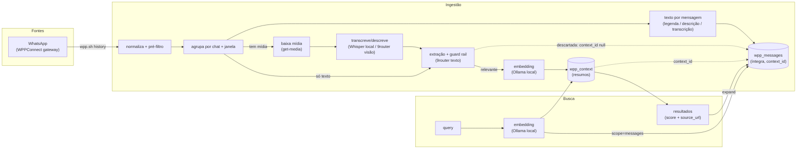

# wpp-context-index

Índice/busca de contexto sobre mensagens WhatsApp (WPP), com ingestão
multimodal (texto/mídia) para Qdrant. Local-first: nenhuma mensagem sai
pra LLM externa (embeddings e descrição de imagem rodam em modelos locais
via Ollama). Ver `docs/PRD.md` para o produto completo.

## Como isso conversa com o WhatsApp

Este projeto **não fala com o WhatsApp diretamente** — ele consome a API
REST de um gateway já rodando em cima do
[WPPConnect](https://github.com/wppconnect-team/wppconnect) (a lib
open-source que abre uma sessão do WhatsApp Web via Puppeteer e expõe as
mensagens por HTTP). `app/adapters/wpp.py` só faz `subprocess` sobre o
`wpp.sh` (script separado, não incluso aqui) que chama esse gateway —
`getAllMessagesByContactId`, `getAllChats`, `getBase64File` etc. Sem um
gateway WPPConnect (ou compatível) rodando e acessível, a ingestão não
tem o que ler.

## Como isso conversa com os modelos

Embeddings vão direto pro Ollama local (`WPP_OLLAMA_URL`). Extração de
texto e descrição de imagem passam por um gateway
[9router](https://github.com/decolua/9router) local (`NINE_ROUTER_URL`,
combo `NINE_ROUTER_COMBO`) — ele escolhe/roteia entre modelos locais e
gratuitos com fallback automático, então nenhuma chamada de texto/visão
depende de uma única API paga fixa. `app/adapters/inference.py` cobre os
dois casos.

## Fluxo



## Setup

```bash
cp .env.example .env   # ajuste WPP_OLLAMA_URL/QDRANT_URL etc.
docker compose up -d
```

Pré-requisitos externos a este repo:
- Um gateway WPPConnect com sessão do WhatsApp autenticada, acessível
  via o wrapper de `wpp.sh` referenciado em `app/adapters/wpp.py`.
- Ollama local com o modelo de `EMBEDDING_MODEL`.
- Um gateway [9router](https://github.com/decolua/9router) local
  (`NINE_ROUTER_URL`) com um combo configurado para `VISION_MODEL`/`TEXT_MODEL`.
- Allowlist de contatos/grupos em `WHATSAPP_ENV_PATH`/`WHATSAPP_LIDS_PATH`
  (arquivos locais, fora do controle de versão — ver `.env.example`).

## Uso da CLI

```bash
python -m app.cli ingest --start 2026-09-01 --end 2026-09-18   # TUI rich com progresso ao vivo
python -m app.cli search "onde mandaram o mockup?"
python -m app.cli search "onde mandaram o mockup?" --expand     # + mensagens na íntegra
python -m app.cli search "0xDEAD" --scope messages              # direto nas mensagens
python -m app.cli backfill-messages --start 2026-08-01 --end 2026-10-01  # popula wpp_messages sem LLM de texto
```

`backfill-messages` é retomável: fontes concluídas ficam em `.data/ingested.json`
(`messages:<alias>`) e são puladas; upsert idempotente. Mídia de unidade sem
resumo não é baixada — vira tag + legenda + `media_ref` (original sob demanda).

### Duas camadas

- `wpp_context`: um resumo por conversa (só o que passou no Guard Rail).
- `wpp_messages`: toda mensagem que passou no pré-filtro, na íntegra e
  sempre em texto (imagem → descrição, áudio/vídeo → transcrição,
  documento → nome + legenda; segredos redigidos; binário nunca salvo).
  `context_id` aponta pro resumo (ou `null` se a conversa foi descartada)
  e `media_ref.fetch_url` pra mídia original sob demanda.

## Uso da API

```bash
docker compose up -d   # ou: uvicorn app.main:app --reload

# dispara ingestão (assíncrona, roda em background) — devolve run_id
curl -sX POST localhost:8000/api/v1/ingest \
  -H 'Content-Type: application/json' \
  -d '{"start": "2026-09-01T00:00:00", "end": "2026-09-18T00:00:00"}'
# → {"run_id": "...", "status": "running"}

# consulta status/resultado (poll até status != "running")
curl -s localhost:8000/api/v1/ingest/<run_id>
# → {"run_id": "...", "status": "completed", "summary": {...}}

# busca
curl -sX POST localhost:8000/api/v1/search \
  -H 'Content-Type: application/json' \
  -d '{"query": "onde mandaram o mockup?", "limit": 5}'
```

`POST /api/v1/ingest` só devolve `run_id` — sem progresso incremental
(a TUI ao vivo é exclusiva da CLI). `filters`/`limit` em `/search` são
opcionais; `"expand": true` anexa as mensagens de cada resumo e
`"scope": "messages"` busca nas mensagens (cada hit traz seu resumo).
`GET /api/v1/source/{id}` devolve as mensagens com texto/remetente/hora.

## Agendamento (ingestão diária via cron do host)

PRD §18 proíbe Celery/Redis/scheduler novo. A ingestão diária roda via
cron do host chamando `scripts/wpp-context-ingest-notify.sh`, que:

1. roda a ingestão (`scripts/ingest-yesterday.sh`) numa **janela de catch-up**
   (default 7 dias, `INGEST_LOOKBACK_DAYS`), um dia por vez;
2. publica o resultado no WhatsApp (contagens, quebra por grupo/contato e os
   títulos dos resumos do dia).

```cron
0 3 * * * /caminho/para/wpp-context-index/scripts/wpp-context-ingest-notify.sh >> ~/Library/Logs/wpp-context-ingest.log 2>&1
```

### Resiliência (roda às 3h, sem supervisão)

Cada falha silenciosa custa um dia de histórico. Por isso:

| Situação | Comportamento |
|---|---|
| Sessão do WhatsApp caída | `bot-off`/`bot-on` automático; se não voltar, o run **continua** e as fontes falham de forma visível |
| Falha ao ler um chat | 3 rodadas de retry com backoff, com re-heal da sessão entre elas; a fonte fica **sem** marcação de "done" |
| `chat_not_found` (JID errado) | 1 tentativa só — é permanente, não polui a contagem de erros |
| Histórico vazio | re-perguntado 3× (~2 min) antes de ser acreditado: o gateway devolve `[]` com HTTP 200 enquanto o WhatsApp Web carrega o chat |
| Dia que falhou | fica sem marcação → a janela de catch-up da noite seguinte reprocessa **só** esse dia |

O estado de "done" é por `(alias, dia)` em `.data/ingested.json`. A CLI divide
a janela em runs de um dia, então dias já completos são pulados sem nenhuma
chamada de API. Rodar à mão um dia específico:

```bash
INGEST_START=2026-11-11 INGEST_END=2026-11-12 ./scripts/ingest-yesterday.sh
```

> O relatório diário é lido do stdout da CLI. A CLI imprime o resumo
> (`ingest: range ... messages_read=N ...`) numa linha própria, porque o painel
> do Rich não termina em newline quando o stdout não é TTY — sem isso o resumo
> cola na borda do painel e todo relatório sai como "0 msgs lidas".
